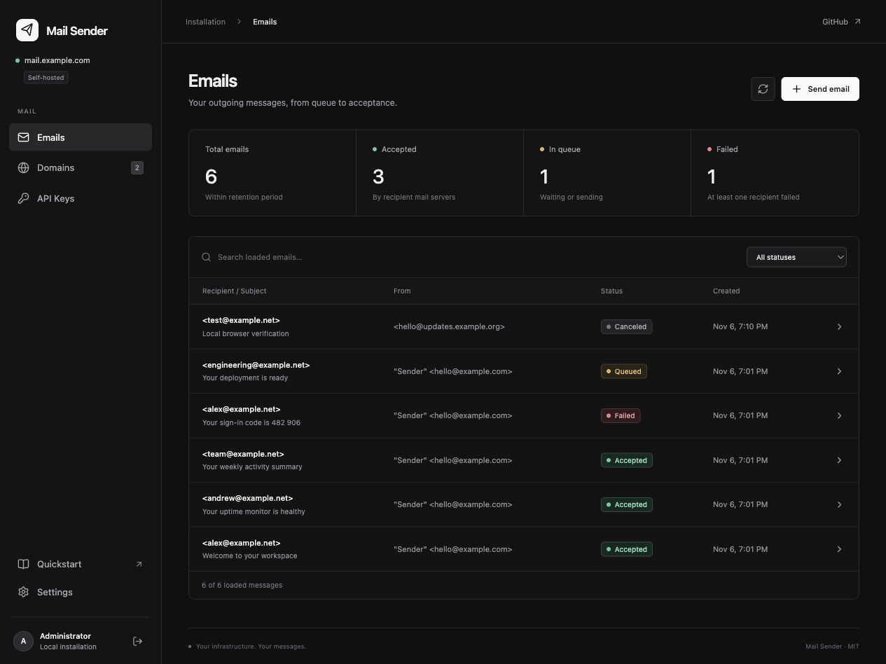
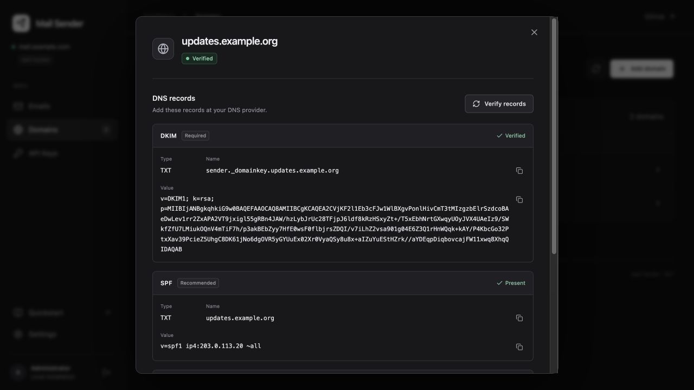
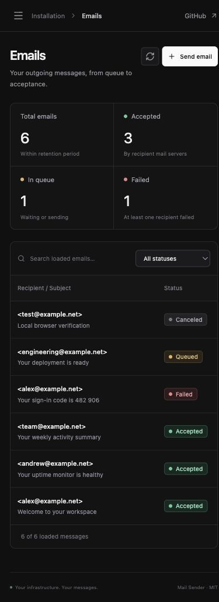

# Release validation

Mail Sender v0.1.0, the release before the LightMail rename, was checked locally on macOS arm64, with Linux containers
for the production images. CI repeats compilation, type checks, SDK and backend
tests, and both container builds.

## Automated checks

- Go vet and race-enabled tests for the backend and dashboard HTTP server.
- Actual HTTP requests from the compiled TypeScript SDK to a Go test server.
- Local SMTP acceptance, MIME text/HTML/attachment parsing, and cryptographic
  DKIM verification of the received message.
- Implicit MX fallback, private destination refusal, TLS-required refusal before
  the SMTP envelope, and acceptance surviving an unsuccessful QUIT response.
- Domain verification, credential boundaries, session invalidation on
  administrator rotation, CSRF protection, idempotency, restart recovery,
  and recipient retry/cancel isolation.
- TypeScript SDK tests for attachment encoding, browser Fetch binding,
  pagination, errors, cancellation, and HTTP request construction.
- Production backend and dashboard Docker builds. The running container stack
  verified the proxy, non-root UID 65532, data-directory mode 0700,
  database mode 0600, and persistence after backend restart.

## Browser checks

The real dashboard and Go API were checked at desktop and mobile widths with
test-only DNS and message fixtures. The fixture exists only in the Go test
binary and never sends internet email.

Sign-in, adding/verifying a domain, a domain-scoped API key, submitting and
canceling a message, HTML preview and delivery activity, quickstart, and
installation settings were exercised. Mobile navigation was checked at a
390 by 844 viewport, with no horizontal page overflow.

The [resource measurements](performance.md) describe the separate idle run.
Internet deliverability and a live Uniac deployment have not been established
by these local fixtures. An operator must configure actual domain DNS, SMTP
egress, and sending IP/PTR, then test with their intended recipients.
